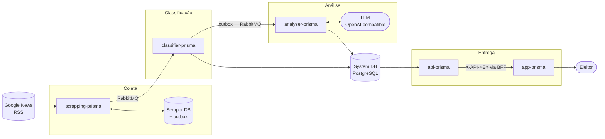

# PRISMA

### O teor da cobertura da imprensa sobre partidos e candidatos, rastreável até a fonte

O PRISMA coleta notícias políticas, identifica os políticos e partidos citados, classifica o teor de cada trecho (**negativo · neutro · positivo**) e gera, com LLMs, panoramas mensais que o eleitor pode conferir matéria por matéria.

---

## Equipe

<table>
  <tr>
    <td align="center"><a href="https://github.com/and3510"> <b>Anderson</b></a> @and3510</td>
    <td align="center"><a href="https://github.com/whosbea"> <b>Beatriz</b></a> @whosbea</td>
    <td align="center"><a href="https://github.com/cristovam10000"> <b>Cristovam</b></a> @cristovam10000</td>
    <td align="center"><a href="https://github.com/gustavodovale"> <b>Gustavo</b></a> @gustavodovale</td>
    <td align="center"><a href="https://github.com/lcsp14"> <b>Lucas</b></a> @lcsp14</td>
    <td align="center"><a href="https://github.com/Furvos"> <b>Nicolas</b></a> @Furvos</td>
  </tr>
</table>

## Repositórios

| Repositório | Stack |
|---|---|
| **[scrapping-prisma](https://github.com/prisma-projetos/scrapping-prisma)** | Python · PostgreSQL · RabbitMQ |
| **[classifier-prisma](https://github.com/prisma-projetos/classifier-prisma)** | Python · PostgreSQL · RabbitMQ |
| **[analyser-prisma](https://github.com/prisma-projetos/analyser-prisma)** | Python · Ollama/LLM · PostgreSQL |
| **[api-prisma](https://github.com/prisma-projetos/api-prisma)** | Java 25 · Spring Boot 4 |
| **[app-prisma](https://github.com/prisma-projetos/app-prisma)** | Next.js 16 · React 19 · Tailwind 4 |
| **[experiments-prisma](https://github.com/prisma-projetos/experiments-prisma)** | Python · scikit-learn · LaTeX |

## Princípios

| | |
|---|---|
| **Rastreabilidade** | Todo número e todo panorama apontam para as matérias que os sustentam |
| **Teor, não viés** | Medimos o que foi publicado sobre cada entidade. Não classificamos veículos nem pessoas no espectro ideológico |
| **IA identificada** | Todo texto gerado por modelo traz o rótulo e o nome do modelo, e cada agregado traz o método e a versão do pipeline |
| **Fronteiras claras** | Cada serviço tem uma responsabilidade, e os serviços se comunicam por mensageria com *outbox* transacional |

## Arquitetura

| # | Etapa | Módulo |
|:-:|---|---|
| 1 | **Coleta** | [`scrapping-prisma`](https://github.com/prisma-projetos/scrapping-prisma) |
| 2 | **Classificação** | [`classifier-prisma`](https://github.com/prisma-projetos/classifier-prisma) |
| 3 | **Análise** | [`analyser-prisma`](https://github.com/prisma-projetos/analyser-prisma) |
| 4 | **Consulta** | [`api-prisma`](https://github.com/prisma-projetos/api-prisma) |
| 5 | **Visualização** | [`app-prisma`](https://github.com/prisma-projetos/app-prisma) |

## Plataforma e DevOps

**Mensageria confiável** · **Idempotência** · **Containers** · **CI/CD + GitOps** · **Kubernetes** · **Segurança** · **Decisões documentadas**

## Pesquisa

Estudo exploratório, protocolo de anotação e decisões de método em **[experiments-prisma](https://github.com/prisma-projetos/experiments-prisma)**.

---

As classificações de sentimento e os panoramas são gerados por modelos de IA e podem conter erros. Os panoramas resumem o que as fontes publicaram, não fatos verificados por esta plataforma.

